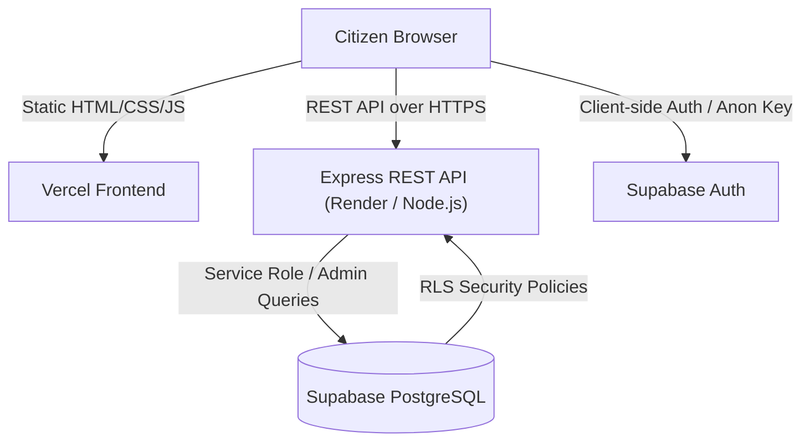

# Waste Wise — System Architecture & Design Specification

## 1. High-Level Overview

Waste Wise is an eco-technology web platform designed to solve urban municipal solid waste challenges in India. The application follows a 3-tier decoupled architecture:
- **Presentation Layer**: Vanilla HTML5, CSS3 design tokens, ES Modules. Static deployment on Vercel or CDN.
- **Application Layer**: Node.js & Express REST API with Helmet security headers, rate limiting, and Zod input validation.
- **Data & Auth Layer**: Supabase PostgreSQL database protected by Row Level Security (RLS) policies, triggers, and JWT bearer authentication.

## 2. Core Subsystems

### A. Deterministic Rule-Based Classification Engine
1. **Input Normalization**: Removes non-alphanumeric punctuation, collapses multi-spaces, lowercases all tokens.
2. **Matching Precedence**:
   - Step 1: Exact string match on canonical name or normalized name.
   - Step 2: Exact alias match (e.g. *chai patti* -> Spent Tea Leaves).
   - Step 3: Phrase containment and multi-word token intersection.
3. **Structured Response**: Returns category slug, color hex, icon, step-by-step household disposal instructions, safety precautions, and rule confidence.
4. **Resilience**: Contains a built-in standard catalog fallback ensuring continuous operation during initial setup or offline tests.

### B. Idempotent Rewards Ledger
- Reward awards must never be fabricated by the browser client.
- Points are granted strictly on the backend.
- Unique `idempotency_key` (e.g., `classify:{userId}:{date}:{itemHash}` or `module:{userId}:{moduleId}`) prevents duplicate point awards for the same activity.
- User balances are derived from ledger history (`SUM(points_delta)`).

### C. Role-Based Access Control (RBAC)
- All users sign up via Supabase Auth.
- An automated database trigger (`handle_new_user`) inserts into `public.profiles` strictly with role `'user'`.
- Role elevation to `'admin'` can only be provisioned through explicit backend administrator scripts or database administrator consoles.
- Backend routes under `/api/v1/admin/*` enforce `requireAuth` followed by `requireAdmin`.

